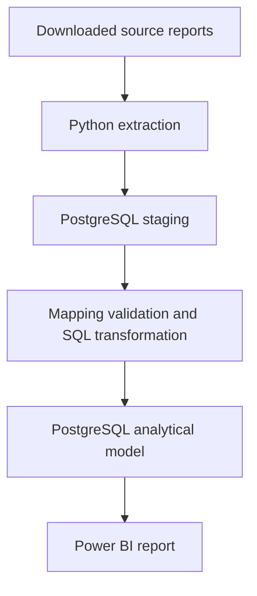

# Domestic Violence in Bulgaria — Data Analytics Project

An end-to-end data analytics project examining registered domestic violence crimes in Bulgaria by region, crime type, location, and offender characteristics.

The project transforms publicly available statistical reports into a structured analytical model using Python, PostgreSQL, SQL, and Power BI. District population data is used to calculate registered crimes per 100,000 residents.

> **Current status:** The Regional Analysis and Offender Characteristics report pages are complete. Crime Location Analysis, automatic downloads from the Ministry of Interior website, and English versions of the report pages remain to be implemented. The next development stage will create separate implementations using Databricks and Snowflake.

## Report preview


The Regional Analysis page provides:

- year-based analysis for 2024, 2025, and 2026;
- a map of registered crimes per 100,000 residents;
- a ranking of the ten districts with the highest registered crime rates per 100,000 residents;
- a breakdown by crime type, including counts and shares;
- monthly crime-count comparisons between selected districts;
- dynamic titles, insights, and report tooltips.

The monthly trend section covers the complete available period and is intentionally independent of the year filter applied to the upper section.

The Offender Characteristics page presents established offenders by crime type, age group, and gender, including the shares of women, offenders aged 14–17, and offenders over 40.

The report pages are currently available in Bulgarian.

## Project objective

The source data is published as separate statistical reports that are not immediately suitable for analysis.

The objective of this project is to build a reproducible analytical workflow that:

- extracts and standardizes the source files;
- preserves the original published values;
- loads the data into PostgreSQL staging tables;
- performs data quality checks on mappings, totals, categories, and reporting periods;
- transforms the data into an analytical model;
- integrates district population data for population-adjusted regional comparisons;
- presents the results through clear and responsible data visualizations.

The project is designed both as an analysis of the available data and as a demonstration of an end-to-end analytics workflow.

## Data

### Crime and offender statistics

The project uses publicly available statistical reports published by the Bulgarian Ministry of Interior.

The loaded crime and offender data covers:

- 2024 — complete year;
- 2025 — complete year;
- 2026 — January through June.

The three source datasets contain information about:

- `crimes_by_region` — registered crimes by police structure and crime type;
- `crimes_by_location` — registered crimes by settlement and location type;
- `established_offenders` — established offenders by crime type, age group, and gender.

Source: [Bulgarian Ministry of Interior](https://www.mvr.bg/gdnp/дейности/домашно-насилие/статистика/регистрирани-престъпления-домашно-насилие)

### Population statistics

District population data is sourced from the Bulgarian National Statistical Institute (NSI).

The model currently includes population totals, men, and women for all 28 districts as of December 31, 2024 and December 31, 2025.

Source: [National Statistical Institute — population statistics](https://www.nsi.bg/statistical-data/206/651)

No personal or case-level information is used in this project.

## Data pipeline



The Python pipeline provides a single entry point for dataset processing. The three Ministry of Interior datasets can be processed for a selected year or, when no year is supplied, for all available years in the corresponding source folders.

Processing logs record progress, successful completion, and failures. Transaction control is managed at the pipeline level: staging loads and analytical transformations for a dataset and year share one database transaction. If processing fails, changes within that transaction are rolled back.

Reloading a selected year replaces its records while preserving data for other years.

The original source files are preserved without modification. Cleaning, name mapping, and transformation are performed separately from the raw data to support traceability and reproducibility.

Source files are currently downloaded manually. Automatic detection and downloading of new or updated Ministry of Interior files is planned.

## Data model

The analytical model separates aggregated statistical measures from descriptive dimensions.

The main dimensions include:

- police structure;
- district;
- crime type;
- location type;
- offender category;
- reporting period.

Districts are maintained separately from police structures so that crime statistics and population data can be analyzed through a common geographic dimension. National-level police structures and published total rows are not treated as districts.

The main fact tables contain registered crimes by region, registered crimes by location, established offenders, and annual district population snapshots.

Key dimensions use predefined IDs that remain consistent when new reporting periods are added or source files are updated.

## Data validation

The pipeline checks for missing dimension mappings before loading data into the analytical fact tables. Additional SQL queries are used manually to investigate source-data consistency, including published totals and category breakdowns.

Identified discrepancies are documented, while the original published values are preserved without modification.

A comprehensive automated data quality test suite has not yet been implemented.

## Regional analysis

The Regional Analysis page combines population-adjusted regional comparisons with absolute crime counts and crime-type shares.

Users can:

- select one reporting year at a time;
- explore districts through the map and ranking chart;
- compare registered crimes per 100,000 residents across districts;
- examine crime counts and shares by crime type;
- compare monthly crime counts for up to four selected districts;
- view district population, crime counts, and rates through report tooltips.

The regional rate is calculated as:

```text
Registered crimes per 100,000 residents =
    Registered crime count / District population × 100,000
```

For 2024 and 2025, the denominator is the population at the end of the corresponding year. For 2026, the calculation uses the latest population snapshot loaded into the model: December 31, 2025.

Rates for 2026 reflect registered crimes for January through June; they are not annualized.

The map uses a consistent color scale across reporting years. The monthly trend chart continues to display absolute crime counts for the full available period, independently of the year selection applied to the upper section.

## Initial findings

For 2024:

- bodily injury was the most frequently registered crime type, accounting for 70.8% of the reported total;
- non-compliance with a protection order was the second-largest category;
- Burgas and Sofia-city recorded the highest regional crime counts;
- population-adjusted comparisons produce a different regional ranking from absolute counts.

These findings describe police-registered crimes and should not be interpreted as estimates of the actual prevalence of domestic violence.

## Limitations

- The data represents crimes registered by the police, not all incidents of domestic violence.
- Population adjustment supports comparisons between districts of different sizes, but differences may also reflect reporting behaviour, police practices, or access to institutions.
- Population denominators are year-end snapshots rather than annual average populations.
- Rates for 2026 use the December 31, 2025 population snapshot because a 2026 snapshot is not currently loaded into the model.
- Crime and offender data for 2026 covers only part of the year. Neither counts nor population-adjusted rates should be compared directly with complete annual values.
- The source reports provide aggregated statistics and do not support case-level analysis.
- The analysis is descriptive and does not establish causal relationships.

## Technologies

- **Python and pandas** — extraction, cleaning, and pipeline orchestration
- **PostgreSQL** — staging and analytical storage
- **SQL** — transformations, mapping validation, and data quality queries
- **Power BI and DAX** — data modelling, calculations, interaction design, and visualization
- **Python logging** — processing logs and error diagnostics
- **Git and GitHub** — version control and project documentation
- **uv** — Python environment and dependency management

Databricks and Snowflake are planned for the next development stage and are not part of the current implementation.

## Repository structure

```text
.
├── config/          # Project configuration
├── data/
│   └── raw/         # Original source files
├── docs/            # Documentation and report images
├── logs/            # Processing logs
├── powerbi/         # Power BI report file
├── sql/             # Schema, validation, and analytical SQL
└── src/             # Pipeline, extraction, loading, and transformation code
```

## Reproducing the analysis

Step-by-step instructions for setting up the environment, loading the source data, building the analytical model, and refreshing the Power BI report will be added as the documentation is completed.

## View the Power BI report

The Power BI report can be downloaded here:

[Download the Power BI report](powerbi/Domestic_Violence_Regional_Analysis_v1_2_CrimesPer100000.pbix)

Power BI Desktop is required to open the `.pbix` file.

The report contains imported public data, so it can be explored without connecting to the original PostgreSQL database. Refreshing the data requires access to the PostgreSQL database used by the project.

## Project status

### Completed

- source-file organization by reporting year;
- extraction and loading of the three Ministry of Interior datasets;
- extraction and loading of district population data for 2024 and 2025;
- PostgreSQL staging tables, analytical dimensions, and fact tables;
- a shared district dimension for crime and population analysis;
- a Python pipeline with dataset selection and optional year selection for Ministry of Interior datasets;
- year-specific data replacement;
- processing logs and transaction control at the pipeline level;
- dimension-mapping checks and SQL data validation queries;
- registered crime rates per 100,000 residents;
- Regional Analysis and Offender Characteristics Power BI pages;
- dynamic report context, interactive filtering, and tooltips.

### Remaining work

1. **Crime Location Analysis** — create a report page for `crimes_by_location`.
2. **Automatic source-file downloads** — detect and download new or updated reports from the Ministry of Interior website.
3. **English report versions** — make the Power BI report pages available in English in addition to Bulgarian.

### Next development stage: Databricks and Snowflake

The next stage will implement the project separately using Databricks and Snowflake, building on the existing Python and PostgreSQL workflow.

Each implementation will cover source-data ingestion, staging, transformations, data quality checks, and the analytical model. The goal is to gain practical experience with both platforms and compare their approaches to the same data-processing requirements.

The Databricks and Snowflake implementations have not yet been developed.

## Report pages

1. **Regional Analysis** — completed
2. **Crime Location Analysis** — planned
3. **Offender Characteristics** — completed

## Author

**Nadya Sevova**
